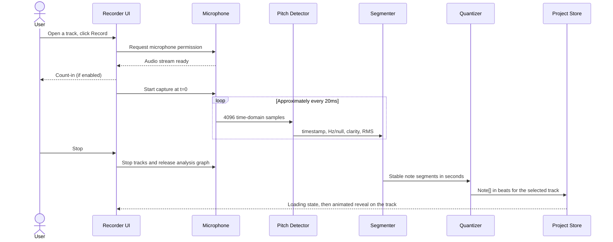

# HumStudio - Software Design Document (SDD)

**Status:** Multitrack music studio, Learn overlays, deterministic generation, editing, undo/redo, and project persistence implemented; education demo validation, physical-microphone tuning, deployment, and human listening pending
**Version:** 1.2 (Education Track alignment)
**Date:** 2026-10-10
**Event:** HackRU Fall 2026  
**Working product name:** HumStudio (rename freely)  
**Audience:** Hackathon developers, reviewers, designers, and AI coding agents

> **Product promise:** Hum a musical idea, see the notes and the theory behind it, edit what you hear, and build a playable arrangement. **Education Track focus:** learning music through an experiment-observe-edit-listen loop.
>
> **Scope principle:** Build a convincing hum-to-music sketchpad with a familiar multi-track layout, not a professional digital audio workstation (DAW).

> [`PRODUCT.md`](PRODUCT.md) made **multi-track core**: one track per instrument, click a track to zoom, record a hum with a live spectrogram, a loading state, then an animated note reveal. That UI now exists. Output is a **generated part for the selected instrument**, not necessarily a 1:1 transcription: local DSP segmentation in `src/lib/audio/segment-notes.ts` feeds instrument/harmony fitting and quantization in `src/lib/generate.ts`. Current implementation status is recorded below; remaining open work is real-device tuning, listening, deployment, and presentation.

## Education Track rationale and implementation status

HackRU's [Education Track](https://www.hackru.org/) focuses on building an educated community. HumStudio addresses an entry barrier to learning music: learners may be able to hum a melody but cannot yet identify its notes, place it on a rhythmic grid, or recognize the underlying chords. The product turns those abstractions into direct visual and audible feedback; it is **not** a formal learning-management system or a demonstrated pedagogical intervention.

**Already implemented in the current code:** Learn (defaults on); live note name, solfège/scale degree and signed cents during voiced recording; per-note pitch/solfège labels; Key selector and inferred harmonic context; chord names plus Roman numerals over the bar ruler; playhead-linked chord highlighting; metronome, Snap, editable notes, mute/solo and five track roles. These are primarily in `Studio.tsx`, `TrackRow.tsx`, and `music/harmony.ts`.

**Not implemented:** lesson plans, quizzes, reference-melody grading, tracked learning progress, teacher accounts, student cohorts, or evidence of improved learning outcomes. Guided exercises and nonvisual pitch feedback are future directions, not current product functionality.

The educational story must remain accurate about the engine: Pitchy + local DSP and heuristics infer pitches/key/chords. Generated Bass/Keys/Strings parts are arrangements rather than a guaranteed faithful transcription. Predicted harmony is an interpretation that students can challenge by editing notes or selecting a key.

## 1. Executive summary

HumStudio is a browser-based, voice-first music **learning and composition** environment with five instrument tracks over an 8-bar 4/4 timeline. A learner records a short monophonic hum, watches a spectrogram and live pitch/degree/cents display, inspects note labels and chord functions in Learn mode, changes pitch or rhythm, and hears the result with mute/solo. MIDI export, sampled instrument choices, project autosave/Save/Open, and undo/redo are implemented. The goal for HackRU's Education Track is to demonstrate how abstract music theory becomes tangible through the learner's own voice.

The project's differentiator is the interface: a person can express a melody with their voice instead of entering notes one at a time. Pitch detection uses Pitchy and deterministic DSP segmentation, with rule-based instrument roles. No trained model or generation backend is implemented.

### Success scenario

1. Open HumStudio in desktop Chrome over localhost or HTTPS and see five instrument tracks (Keys and Drums hold labeled sample parts).
2. Click the **Melody** track; it zooms and floods with its color.
3. Leave **Learn** enabled, click **Record**, allow microphone access, and hum a clear 4-8-note melody for 5-10 seconds; point to the live pitch name, solfège/degree, cents displacement, and spectrogram.
4. Stop. Inspect the note reveal, labeled note bars, the inferred key, and the bar-by-bar chord symbols and Roman numerals; explain these are software interpretations.
5. Change one note pitch or **Snap** setting, then replay to hear the effect; compare the bar grid and metronome.
6. Return to all tracks, mute/solo Bass or Keys to hear its role, and play the full arrangement.
7. Export a `.mid` file or save the project to `.humstudio.json`; state one learner takeaway rather than only showcasing the song.

## 2. Problem, users, and goals

### Problem statement

Both music-theory instruction and music software can assume students already understand notation, keyboard layout, scale degrees, and chord names. Someone who can *hear* or hum a melody may not know how its pitches map to named notes, how phrases align to beats, or why chord changes matter. HumStudio provides a concrete, exploratory bridge from a familiar input (voice) to those concepts without requiring keyboard proficiency.

### Target users

- **Primary:** Beginner music learners, school/college students, and self-taught creators exploring pitch, rhythm, key, harmony, and arrangement.
- **Facilitators:** Teachers, tutors, and club leaders who want to demonstrate those concepts visually; no teacher dashboard or accounts exist.
- **Secondary:** Songwriters and producers capturing ideas without performance skills.
- **HackRU judges:** Should understand one educational takeaway in the live demonstration, not just how quickly a song is produced.

### Primary goals

- Help learners **identify** a sung note and its scale degree/solfège, and **locate** it on the note grid.
- Help learners **observe** how BPM, a metronome, and Snap change the placement and feel of a rhythm.
- Help learners **connect** an inferred or chosen key to chord names, Roman numerals, and distinct instrument roles.
- Let learners **form and test a hypothesis** by editing a note or changing a setting and listening to the result.
- Reduce time from vocal idea to editable notes and make the result visually understandable and musically playable.
- Keep the app reliable under live-demo constraints (unknown microphone, browser permissions, noise).
- Avoid account creation, server setup, API keys, and model downloads for the MVP.

### Non-goals for HackRU MVP

- Polyphonic transcription, chords from voice, or separating vocals from background music.
- Full audio-track editing, waveform comping, effects chains, mixing, or mastering.
- Perfect transcription of vibrato, portamento, fast ornaments, breath sounds, or repeated pitches without clear articulation.
- Training or hosting a custom machine-learning model.
- Cloud collaboration, user accounts, or billing.
- A full DAW: no audio tracks, mixer, or arbitrary track creation. The five instrument tracks are fixed.
- Graded ear-training exercises, quizzes, certifications, adaptive difficulty, classroom management, progress records, or claims of validated learning improvement.
- Guaranteed-correct key/chord labels: they are algorithmic suggestions and may require manual correction.

## 3. Scope and priorities

| Tier | Deliverables | Rationale |
|---|---|---|
| **P0 - demo-critical** | Five-instrument arrangement view **(built)**; click-to-zoom track **(built)**; mic permission and capture with live spectrogram **(built)**; loading state and animated note reveal **(built)**; Tone.js playback of all tracks with mute/solo, BPM, play/pause/stop/rewind **(built)**; multi-track MIDI export **(built)**; demo-hum fallback and error states **(built)**; deterministic melodic generation (pitch, segmentation, quantization) **(built; real-device tuning pending)**; drag notes to change pitch/time and basic length edit **(built)**; local autosave and JSON project export/import for all tracks **(built)** | Completes the end-to-end promise and makes the output reusable. |
| **P0 - Education Track demo** | Learn toggle with note name/solfège labels, detected pitch/scale degree/cents, key selector, chord symbols and Roman numerals, bar highlighting, instrument role explanations **(all built; educational review and real-device validation pending)** | Shows the cause-and-effect learning loop, not merely a music-production workflow. |
| **P1 - polish** | Four-beat playback count-in and metronome **(built; listening pending)**; recording count-in with click **(built; listening pending)**; manual add/delete, collision-aware editing, undo/redo, Clear/Repeat, keyboard shortcuts, and confirm-before-overwrite **(built)**; instrument sound polish and demo rehearsal remain | Increases demo clarity and resilience. |
| **P2 - stretch** | Guided pitch/rhythm exercises, teacher-authored activities, optional learning progress (with opt-in privacy), richer screen-reader pitch feedback; generation backend or ML arrangement model; Supabase login/cloud saves; uploaded audio; MIDI import; user-created tracks; collaboration | Valuable later, but not required to demonstrate the core product. |

**Scope cut rule:** If the transcription, editing, and playback loop is unstable, cut P1/P2 before attempting new features. When time is tight, allow note duration editing through a numeric control rather than sophisticated edge dragging.

## 4. Functional requirements

| ID | Requirement | Verification |
|---|---|---|
| FR-01 | User sees five instrument tracks over an 8-bar, 4/4 timeline; each zoomed track shows its own pitch range (e.g. Melody C4-C6, Bass E1-E3) or drum rows. **Built.** | Sample notes render at the correct beat and pitch. |
| FR-02 | User can set BPM from 60-180. **Built** (default 120). | Playback tempo changes without modifying note positions. |
| FR-03 | Play, Pause (preserves position), Stop (resets to zero), and Rewind work; synthesis begins only after a click unlocks audio. **Built.** | Sample Keys + Drums play in time. |
| FR-04 | User can open a track, request microphone access, start and stop capture, and see permission/errors. **Built.** | Test allow, deny, insecure origin, and missing-device paths. |
| FR-05 | A single-voice hum becomes timed notes for the selected instrument through **implemented local DSP and role/harmony heuristics**; real human microphone quality remains unverified. | Clean 4-8-note phrase produces mostly correct pitches in the instrument's range. |
| FR-06 | Quantization can be Off, 1/4, 1/8, or 1/16 notes. **Built** (default 1/4). | Note onsets/ends snap to the selected grid. |
| FR-07 | Notes are editable in the zoomed track, including pitch/time move, edge resize, delete, add and undo/redo. **Built.** | Drag C4 to D4 and move a note one grid step. |
| FR-08 | The project (all tracks) autosaves locally, and users can export/import validated v2 project JSON. **Built.** | Refresh and file round-trip preserve every track, BPM, and mute/solo. |
| FR-09 | User can export standard MIDI with one track per instrument at the project tempo. **Built.** | Open the `.mid` in a MIDI-capable app; drums on channel 10. |
| FR-10 | Microphone tracks are stopped after recording, errors, or unmount. **Built.** | Browser recording indicator stops after cleanup. |
| FR-11 | While recording, a live spectrogram draws over the zoomed track; a loading state covers generation; notes are revealed with an animation (skipped under reduced motion). **Built.** | Visual check; reduced-motion check. |
| FR-12 | Mic failure or an empty take shows a clear message and a labeled **Demo hum** option; existing notes are never erased. **Built.** | Deny permission, then record silence. |
| **EDU-01** | Learner toggles **Learn** without altering audio or note state. **Built; defaults on.** | Toggle off/on; check theory labels appear/disappear while the same notes still play. |
| **EDU-02** | During voiced capture, learner sees a note name, degree/solfège or "outside the key," and signed cents offset from the nearest semitone. **Built as a visual readout.** | Sing/simulate stable C4 then silence; verify numbers/needle and no-pitch state; no correctness grade is shown. |
| **EDU-03** | Zoomed melodic notes display pitch name and solfège with Learn enabled. **Built.** | Move a note and check label and playback match the new MIDI pitch. |
| **EDU-04** | Learner sees inferred/selected key, one chord per bar, chord symbol and Roman numeral; active bar highlights during playback. **Built.** | Select a known key and play 4/4 bars; verify chord/degree mapping and highlighting. |
| **EDU-05** | Learner compares unsnapped vs quantized rhythm and instrument roles by editing, Snap, metronome, mute/solo. **Built as tools, not as a lesson or assessment.** | Demonstrate an audible difference and explain which beat/note changed. |

## 5. Nonfunctional requirements

- **Target environment:** Desktop Chrome/Edge, modern browser, laptop microphone or headset; localhost/HTTPS. Mobile support is best effort.
- **Performance target:** Short recordings (up to 15 seconds) should normally become notes within 2 seconds of stopping on a typical development laptop. This is a test target, not a guarantee.
- **Audio safety:** User gesture required before starting Tone.js audio; avoid feedback and route the microphone only to analysis, not speakers.
- **Data privacy:** Raw microphone audio remains on device and is not uploaded or persisted by default. Saved project files store **note data**, not audio samples.
- **Reliability:** Microphone denial or weak detection must not crash the editor. The labeled Demo hum and sample parts remain usable.
- **Maintainability:** Pure transformations (Hz to MIDI, segmentation, quantization, serialization) are independent of React and Tone.js.
- **Accessibility:** Visible labels and focusable controls; recording/playback/mute/solo state never conveyed by color alone; reduced motion skips the reveal choreography.
- **Security:** Treat imported JSON as untrusted: validate it, bound lengths and numbers, and fail without overwriting the current project.
- **Educational integrity:** Labels derive from currently selected/inferred harmony and MIDI, not a prewritten answer key; never present an inferred key or transformed part as objectively correct transcription. The live cents indicator is pitch estimation, **not** a learner score.
- **Education accessibility limitation:** The current `LivePitch` container is `aria-hidden` and changes via DOM refs; nonvisual equivalents are future work. Do not claim it is accessible to screen-reader users without verification.

## 6. System context and architecture

```mermaid
flowchart TD
    User[User hums and edits] --> UI[Next.js / React client UI]
    UI --> Mic[Browser getUserMedia]
    Mic --> Frames[Web Audio time-domain frames]
    Frames --> Pitch[Pitchy pitch + clarity]
    Frames --> Spec[Spectrogram bins, display only]
    Pitch --> Gen[generateTrack: segment / quantize / fit to instrument]
    Gen --> State[Studio state: Track array]
    UI <--> State
    State --> Piano[Track lanes: render, reveal, edit]
    State --> Learn[Learn labels: pitch, solfege, chords, roman numerals]
    Frames --> PitchUI[Live pitch / cents, when voiced]
    PitchUI --> Learn
    State --> Playback[Tone.js Transport + smplr / synth fallback]
    State --> Save[Local storage + JSON file]
    State --> Midi[@tonejs/midi export]
    Playback --> Out[Audio output]
```

### Architectural boundary

**Client-side today.** Next.js provides the shell; interactive audio/editor code runs in Client Components (`'use client'`) or browser-only modules. No API routes exist. A future generation backend plugs in behind `generateTrack(...)`; if it is remote, sending audio or pitch data off-device needs an explicit team decision and user consent (see privacy). Supabase is deliberately excluded until the core flow is proven.

### Component responsibilities

| Component/module | Responsibility | Status |
|---|---|---|
| `src/components/Studio.tsx` | App shell: transport bar, ruler, row layout, canonical `Track[]` state, record → generate → reveal flow, playhead. | Built |
| `src/components/TrackRow.tsx` | One track: arrangement clip or zoomed lane with prompts, phases, pitch labels, note reveal, and editing gestures. | Built |
| `src/components/Spectrogram.tsx` | Live halftone canvas of the hum on the lane's pitch axis. Display only. | Built |
| `src/lib/tracks.ts` | `Instrument`, `Track`, `INSTRUMENTS`, labeled sample parts, lane geometry helpers. | Built (shared contract) |
| `src/lib/hum.ts` | `getUserMedia`, AnalyserNode, Pitchy pitch/RMS gating, `HumFrame` stream, demo hum, teardown, mic error messages. | Built (needs real-mic testing) |
| `src/lib/generate.ts` | `generateTrack(instrument, frames, bpm, quantize, harmony) → Promise<Note[]>`; pure `generateNotes` for fixtures. | Built (DSP heuristics; real-device tuning pending) |
| `src/lib/playback.ts` | Browser-only facade for scheduling, play/pause/stop/rewind/position, metronome, count-in, and teardown; delegates to `src/lib/audio/`. | Built (playback regression tests; listening pending) |
| `src/lib/midi.ts` | `Track[]` → multi-track `.mid` download. | Built |
| `src/lib/music/types.ts` | Shared `Note`/`QuantizeDivision` contract. The legacy `Project` shape remains a compatibility contract; current saved projects use `ProjectV3` in `src/lib/persistence/project.ts`. | Built |
| `src/lib/audio/segment-notes.ts` | Stabilize gated `HumFrame` pitch into second-based segments with rest boundaries. | Built (synthetic regression fixtures; real-device tuning pending) |
| `src/lib/persistence/project.ts` | Validate/store/reopen multi-track project JSON, with v1 migration. | Built |
| `src/lib/music/harmony.ts` | Key inference/override, chord naming, Roman numerals, scale degrees, movable-do solfège. | Built; harmony remains a heuristic |
| `src/components/TrackRow.tsx` Learn subviews | LivePitch (`hzToMidi` plus signed cents), Key/Role summary, LaneChords, note labels. | Built visually; nonvisual pitch feedback pending |

### Data flow: capture to MIDI notes



**Important timing rule:** `t=0` is when active recording starts, **after** microphone permission and any count-in. Never include the permission prompt or count-in in the note timestamps.

### Data flow: playback and export

The store retains note pitches and timing **in beats**, per track. Lanes render those beats as x coordinates.Tone.js schedules note-on/off events using the current tempo. Export converts beats to seconds (or MIDI ticks) at the project tempo and writes a standard MIDI file. Changing the BPM therefore changes playback/export tempo without altering the saved note arrangement.

## 7. Canonical data model

The following is the shared contract (`src/lib/music/types.ts`). All developers and agents must use these property names. The multi-track app state built on top of it follows the code block.

```ts
export type QuantizeDivision = "off" | "1/4" | "1/8" | "1/16";

export interface Note {
  id: string;            // Unique within the project
  midi: number;          // Integer 0..127; 60 = C4
  startBeat: number;     // >= 0; zero-based quarter-note beats
  durationBeats: number; // > 0, e.g. 0.5 = eighth note
  velocity: number;      // 0..1
}

export interface Project {
  schemaVersion: 1;
  id: string;
  name: string;
  bpm: number;           // 60..180 in the MVP
  quantize: QuantizeDivision;
  notes: Note[];         // One synth track in MVP
  createdAt: string;     // ISO timestamp
  updatedAt: string;     // ISO timestamp
}
```

**Invariants:** Each note has finite numeric values, `midi` is an integer in 0..127, `startBeat >= 0`, `durationBeats > 0`, and `0 <= velocity <= 1`. Project BPM is finite and 60..180. Notes are sorted by `(startBeat, midi, id)` for deterministic rendering/export. The editor may support overlapping notes via a polyphonic synth even though voice transcription is monophonic.

**App state is multi-track.** `src/lib/tracks.ts` defines:

```ts
interface Instrument { id: string; name: string; color: string; lo: number; hi: number; kind: "synth" | "drums"; hint: string }
interface Track { instrument: Instrument; presetId: string; notes: Note[]; muted: boolean; solo: boolean; sample: boolean }
```

`Studio.tsx` holds `Track[]` (one per instrument in `INSTRUMENTS`), plus `bpm` and `quantize`. `sample: true` marks preset parts shown with a "Sample" label until a recording replaces them. Drum notes use General MIDI kit numbers (36 kick, 38 snare, 42 closed hat, 46 open hat, 49 crash).

**Learn state:** `Studio.tsx` initializes `learn=true` as an ephemeral view toggle; note and chord labels are **derived** from MIDI and `Harmony`, not independent saved grades or lesson progress. `LivePitch` reads the newest voiced `HumFrame.hz` and does not persist pitch samples.

**Saved format:** schema v3 stores all tracks, sounds, notes, flags, per-instrument Snap/Sensitivity, shared BPM/harmony, metadata, and bounded note-only regeneration sources. v1 notes migrate to Melody; v2 global settings apply to every instrument. Missing preset IDs get defaults. Unknown or malformed fields reject. Musical detections, phrase boundaries and capture BPM restore sensitivity/grid regeneration without full analysis frames or audio. Edited/older parts keep their notes when sensitivity sources are unavailable. See `src/lib/persistence/project.ts` and `TECHNICAL_SPEC.md` §3.1.

## 8. Audio analysis design

### 8.1 Microphone acquisition

- Use `navigator.mediaDevices.getUserMedia({ audio: { echoCancellation: false, noiseSuppression: false, autoGainControl: false } })` where the browser permits; these are preferences, not promises.
- Use Tone's shared browser audio context to create a `MediaStreamAudioSourceNode`, an analysis-only worklet, and an `AnalyserNode` with `fftSize = 4096`.
- An AudioWorklet (`public/hum-worklet.js`) delivers every mic sample in 20 ms hops; `src/lib/hum.ts` runs Pitchy on a 4096-sample sliding window per hop. Unlike animation-frame polling, no readings are lost when the page is busy or hidden, and the rate is the same on every display. The AnalyserNode's frequency data feeds the 48-bin spectrogram display only.
- Use the **actual** `audioContext.sampleRate` (not a guessed 44.1/48 kHz value).
- Timestamp each frame relative to recording start (`hum.ts` uses the audio clock: the worklet's sample index at the centre of each analysis window).
- Disconnect graph nodes, stop every `MediaStreamTrack`, stop the worklet, and close its message port after recording or any setup failure. Cleanup is idempotent and leaves Tone's shared context available for playback.

### 8.2 Pitch estimation

- Use `PitchDetector.forFloat32Array(4096)` and `findPitch(buffer, sampleRate)` from Pitchy.
- Pitchy returns estimated fundamental frequency in Hz and a clarity score in `[0,1]`.
- Initial gates (tune using real device tests): clarity >= **0.85**, RMS >= **0.01**, frequency in **80..1000 Hz**. Invalid frames are unvoiced (`hz = null`).
- Convert frequency to continuous MIDI pitch: `69 + 12 * log2(hz / 440)`, then stabilize before rounding to the nearest semitone. A simple strongest-FFT-bin detector is explicitly not recommended because vocal harmonics can exceed the fundamental.

### 8.3 Segmentation

1. Suppress isolated outliers with a sliding median across approximately five valid frames (or similar robust smoothing).
2. Require 120 ms of consistent pitch before opening a note; retain the active/candidate pitch within a 0.7-semitone hold region to suppress vibrato.
3. When a different pitch is stable for 120 ms, close the previous segment and start the next one at the candidate onset.
4. Preserve pitch history across unvoiced gaps <= 150 ms. Longer silence closes at the last voiced frame and marks a new phrase; missing-frame gaps also separate phrases. Thresholds are measured in seconds independently of BPM.
5. Melody retains confirmed rounded pitches and defines harmony after the take; other melodic parts fit that harmony. Merge identical pitches within the same phrase before snapping. Confirmed rests still separate notes. Reject fragments shorter than 100 ms in Medium.
6. Preserve the first and last observed voiced timestamps within the recording window.

These constants are **starting heuristics**, configured as the Medium profile in `src/lib/audio/note-sensitivity.ts` (`SEGMENTATION_DEFAULTS`). A level dip and return on one pitch re-strikes the note (1.8x RMS), but near-silence <= 150 ms is bridged and fast pitch changes can be suppressed. Real-device tuning uses scored takes in `src/tests/takes/`. Low uses a 1.5-semitone hold, 200 ms stability, and seven-frame median; High uses 0.5 semitones, 60 ms stability/minimum note, and three frames. All profiles are retained as note-only musical sources per latest take for independent track switching and Save/Open regeneration. Drum onset sensitivity uses distinct RMS gates and rise ratios; Medium retains the prior tuning. Snap rebuilds using the capture BPM, preserving beat positions after tempo changes and original timing for Off. Manual edits opt out of profile swaps; a picked key persists until a new Melody take.

### 8.4 Beat conversion and quantization

For an event with timestamps `startSec` and `endSec` relative to recording start:

```text
startBeat = startSec * bpm / 60
endBeat   = endSec   * bpm / 60
```

A 1/16-note grid is `0.25` quarter-note beats; 1/8 is `0.5`, 1/4 is `1.0`. Snap each boundary to the nearest grid point, then clamp the duration to at least the chosen grid step when quantization is on. When off, retain raw beat timing with a small positive minimum duration. Clamp negative starts to zero and prevent segmentation/rounding from producing invalid note lengths. For a single-voice transcription, prevent **accidental** overlaps created by snapping; deliberate overlaps added by the user can remain.

## 9. Audio playback design

- Initialize browser sample resources after project restoration without resuming audio or starting transport. Preload all five selected sounds, including empty/muted tracks; await `Tone.start()` in a user gesture handler before playback or capture.
- Instrument voices on one shared `Tone.getTransport()`: smplr presets on Tone's underlying audio context, with the existing `PolySynth`/percussion sounds retained as fallback. Expanded tracks select their own serializable `presetId` without changing notes. Lazy loading, stale-request guards, and shared buffer reuse live in `preset-manager.ts`/`smplr-backend.ts`. Unique per-attack stop handles preserve overlapping equal pitches. Kit-specific aliases play the same GM drum notes; regular note-offs leave one-shots intact. Mute/solo are applied at schedule time.
- Studio keeps Solo exclusive in canonical state, independently of Mute; muted tracks stay silent even if soloed. Older multi-solo files keep the first soloed category in fixed instrument order without changing notes. Sample loading/failure feedback stays inside the relevant Sound section so it cannot move the ruler or track region.
- Set transport BPM from the canonical studio BPM state; schedule track notes at their beat positions, converting beats to musical ticks/transport positions rather than hard-coding wall-clock seconds.
- Schedule synth triggers with the **precise audio time argument** provided by the transport callback.
- On project updates, stop or safely reschedule the old events. Track the scheduled event IDs and clear them; do not accumulate duplicated notes.
- Pause preserves the playhead position while releasing active voices; Stop halts playback, releases voices, and resets to zero. Rewind returns the playhead to beat zero while preserving running/paused state. Also release voices when changing projects or unmounting.
- Optional metronome and four-beat count-in use the audio clock. Count-in precedes playback and recording; while recording, only the click plays.
- Fixed 4/4 timeline. The transport loops the 8-bar arrangement; no mixed time signatures.

## 10. Track lanes and interaction design

- **Arrangement view:** five rows share the viewport height; each row is a flood-colored header (name, M/S) plus a lane with a bar/beat grid. Generated parts render as solid flood clips with ink note bars; sample parts render outlined.
- **Zoomed view:** clicking a row zooms it; the others collapse to 36 px strips. The zoomed lane fills with the instrument color, labels C rows (or drum names), and hosts recording, spectrogram, loading, and reveal. Drums expose a Kick/Snare/Closed hat/Open hat/Crash selector; all five rows stay visible, recording/move/resize/add/Clear/Repeat use only the selected lane, and right-click can delete any visible note through the full-track owner. The full kit remains playable and saved.
- Geometry is derived, never stored: x = `startBeat / 32` of lane width; y = `(instrument.hi - midi) / rows` of lane height (`src/lib/tracks.ts`).
- 8 bars x 4 beats = 32 beats, fitted to the viewport width (no horizontal scroll yet).
- Grid lines for bars/beats and labels for C notes.

**Editing (implemented, Person 3):**

- Drag body horizontally to adjust start beat; drag body vertically to adjust pitch in semitones; drag right edge to adjust duration. Snap horizontal edits to the selected grid (Off = fine movement).
- Keep click-to-select distinct from drag behavior. `pointerdown` -> `pointermove` -> `pointerup`; handle pointer cancellation.
- Prioritize note editing over a mixing console or extra visual effects.

### Learn mode and educational interaction (implemented)

Education is a **view and exploration layer** over the same note/harmony state, not a separate scoring or inference engine:

- The transport's **Learn** button (initially enabled) toggles theory labels without mutating `Track[]`, `Note[]`, or audio; shortcut `L` works outside inputs.
- `LivePitch` appears **only during recording** for pitched tracks when Learn is enabled. It calculates continuous MIDI `m = 69 + 12 log2(hz/440)`, rounds to the nearest note `n`, and shows `midiName(n)`, `solfege(n, harmony)`, `scaleDegree(n, harmony)` or "outside the key," and `round(100 * (m - n))` cents. Null input shows "no pitch." This is visual feedback, not a validated intonation grade.
- When Learn is on, zoomed melodic note bars show a pitch name plus solfège. Move a note to test the relationship between height, sounding pitch, and label; reselecting the key changes its theoretical context.
- `LaneChords` shows each bar's chord symbol and `romanNumeral(chord, harmony)` with the current bar highlighted during transport playback; the zoomed spine shows Key and instrument **Role**. These labels use existing `music/harmony.ts` functions, not a separate content model.
- Snap, BPM, metronome, mute/solo, note editing, and sampled instruments let learners **compare** rhythm, instrument role, and timbre. A guided three-note lesson is **not** currently part of the UI.
- Key inference can be uncertain for short/ambiguous melodies. Teaching copy must call it an *inferred* or *suggested* key, and explain that role-shaping can change Bass/Keys/Strings from exactly what was hummed. The manual Key control allows exploration/correction.

**Education Track success demonstration:** A judge hears a learner hum, sees pitch/degree and a labeled note, observes a chord change on the grid, edits or snaps a note, and hears the difference. Real learner testing is not complete.

### Current state ownership and future refactor

Today `Studio.tsx` owns tracks and settings in React state, replaces arrays immutably, and synchronizes an arrangement ref for asynchronous operations. Undo/redo snapshots also preserve metadata, key decisions, capture tempo, cached sensitivity variants, and original Snap sources. Open validates before applying, restores saved note-only sources, and clears transient copy previews. A future reducer may consolidate these track-scoped mutations. Audio objects/streams/timers stay in refs or service modules, **not** in serializable state.

## 11. Persistence and export

### Project JSON (implemented)

- Save **all tracks** (instrument id, notes, mute/solo) plus BPM and quantize, in the versioned multi-track format from section 7.
- Autosave project JSON to `localStorage` key `humstudio:project:v2` after a 400 ms debounce; skip incomplete recording states.
- **Save Project:** download `<safe-name>.humstudio.json`.
- **Open Project:** use an explicit user-selected `.json` file, validate schema/invariants, then replace current project on success only.
- Handle unavailable/blocked/full local storage with a nonfatal UI warning.
- v1 files migrate to Melody; unsupported versions or invalid input produce a helpful error without replacing notes.

### MIDI

- Instantiate `new Midi()` from `@tonejs/midi`.
- Validate BPM/notes, set the file tempo, and add **one MIDI track per non-empty instrument track** with distinct melodic channels and Drums on channel 10. Beat boundaries map to PPQ ticks, with at least one tick of duration. Pure `createMidiBytes` is tested; `exportMidi` downloads `humstudio.mid` and always revokes the object URL.
- Export `midi.toArray()` as a downloaded `audio/midi` or `application/octet-stream` Blob with `.mid` extension.
- JSON is the **editable HumStudio project**; MIDI is the **interchange format**. MIDI does not preserve UI-only project settings.

## 12. Reliability, failure states, and fallbacks

| Failure | Expected behavior | Demo fallback |
|---|---|---|
| User denies microphone | Clear permission guidance in the zoomed track; editor remains functional. | **Demo hum** (labeled) or sample parts. |
| No input device / insecure HTTP origin | Show device/HTTPS explanation without crashing. | Demo hum; sample Keys/Drums. |
| Background noise / poor pitch confidence | "We didn't catch a hum..."; existing notes preserved. | Retry in a quiet room with headphones; Demo hum. |
| Generator returns no notes or throws | Error state with retry; existing notes preserved. | Demo hum. |
| Audio autoplay restriction | Enable audio on first Play/Record gesture. | Click dedicated "Enable audio" control. |
| Metronome leaks into microphone | Suggest headphones; optionally disable clicks during capture. | Record without audible metronome after count-in. |
| Analyser frame timing jitter | Quantize to beat grid; keep short recordings. | Re-record slower melody. |
| Bad imported JSON | Reject with explanation; never wipe project. | Restore local autosave. |
| Storage quota / private browsing | Offer file export even if autosave fails. | Download JSON before closing page. |

## 13. Testing and evaluation

### Automated checks

- Implemented: TypeScript regressions using Node's built-in test runner cover playback, preset loading/voices, harmony, segmentation, generation, cached settings, microphone resource cleanup, MIDI encoding, project persistence, and editing. Fixtures include wobbles/dropouts, real rests, all three profiles, preserved Melody pitches, capture-tempo Snap, invalid input, stale callbacks, fallback/retry, sample lifetimes, independent MIDI channels, download cleanup, strict project schemas, and collision-aware edits. Preset browser evidence and remaining human checks are in [`SMPLR_INTEGRATION.md`](SMPLR_INTEGRATION.md).
- Implemented: project JSON round-trip and v1 migration tests retain BPM, notes, settings, and track flags; malformed, oversized, and unexpected fields reject before changing the studio.
- Implemented: time-stamped synthetic `HumFrame[]` fixtures with known pitches, vibrato, short noise, and dropouts.
- **Education tests:** `src/tests/harmony.test.ts` already covers major/minor Roman numerals, degrees, solfège and out-of-scale null cases. **Still to verify in the browser:** note labels after an edit/Key change, Learn as a view-only toggle, LivePitch's "no pitch" silence behavior, and readable/focusable theory UI with a beginner. Function-level tests do not establish interface accessibility or learning outcomes.

### Manual test matrix

- Chrome and Edge on a real laptop, speaker and headphone mode.
- Allow/deny mic, stop mid-capture, restart recording, leave page while recording.
- Clean hummed scale; short rests; note repeated with silence; deliberately noisy input.
- BPM 60, 120, 180; quantization Off and 1/16.
- Play, stop, replay, edit a note, replay again; verify no duplicate synth events.
- Save/import JSON and export MIDI; inspect note placement in a MIDI viewer/DAW.
- In Learn mode, hum one stable reference pitch; verify note name, scale degree and signed cents; sing silence and verify no-pitch state. Repeat with a chosen key.
- Turn Learn off/on: notes, transport, and save/export must be unchanged; toggle and inspect chord/Roman-numeral labels.
- Conduct a short novice walkthrough: can someone explain one note label, bar/chord, and audible edit without being told what to click? Record observations, not fabricated learning outcomes.

### Definition of done (P0)

A team member can run the app locally, open a track, hum a short single-voice melody, see generated notes revealed on that track, **enable Learn, identify a sung note/scale degree and at least one chord/Roman numeral, change a note or Snap, and explain what changed audibly**, hear the arrangement, save/reopen a project JSON file, and export a valid multi-track MIDI file. Permission denial and empty/failed transcription are handled gracefully. The build/lint/type checks pass on the merged branch.

## 14. Engineering milestones and ownership

| Phase | Main deliverable | Dependency |
|---|---|---|
| 1. Contract + scaffold | TypeScript data model; Next.js; sample parts; studio layout **(done)** | None |
| 2. Studio + playback | Tracks, zoom, transport, BPM, synths, MIDI export, record/spectrogram/reveal flow **(done)** | Shared note contract |
| 3. Capture + analysis | Mic input, Pitchy frames, clear statuses | Browser setup |
| 4. Segmentation + quantization | `HumFrame[] -> Note[]` working with fixtures **(done; real-microphone tuning pending)** | HumFrame contract |
| 5. Integration | Real `generateTrack` output lands on the selected track; notes editable; arrangement plays **(done)** | Phases 2-4 |
| 6. Finish | JSON persistence, MIDI export, tests **(done)**; real-device tuning, listening, deploy, demo rehearsal **(open)** | Stable main workflow |
| **7. Education Track story** | Learn labels, chord/degree/cents UI **(built)**; education-centered live demo, explanation copy/verification and novice walkthrough **(open)** | Reliable pitch/key and editor |

Ownership is assigned in [`WORKLOAD_SPLIT.md`](WORKLOAD_SPLIT.md): **voice-to-notes**, **playback/transport**, **track editor**, and **integration/branding/persistence**. Work in parallel behind the interfaces in `TECHNICAL_SPEC.md`.

## 15. Risks and architectural decisions

| Decision | Choice | Why |
|---|---|---|
| ADR-001 | Client-only audio/DSP | No network latency, API keys, or backend dependencies; better privacy. |
| ADR-002 | Pitchy over strongest-bin FFT | Handles fundamental estimation more robustly for monophonic voice. |
| ADR-003 | Store note time in beats | BPM changes do not distort arrangement positions. |
| ADR-004 | Flat `Project.notes[]` in the v1 contract; app state is `Track[]` | v1 contract stays stable; the multi-track save format gets a new version (v2) rather than a silent change. |
| ADR-005 | Local JSON + MIDI before Supabase | Demonstrable persistence/export without auth or cloud setup. |
| ADR-006 | Desktop Chrome/Edge first | Limit browser variability during a weekend build. |
| ADR-007 | DSP terminology is accurate | Do not advertise model training or neural AI that is not implemented. |
| ADR-008 | Multi-track instrument editor is P0 | `PRODUCT.md`: the demo is "pick an instrument, hum, watch it fill"; overrides the original single-track P0. |
| ADR-009 | Generation behind one function (`generateTrack`) | Keep the UI independent of DSP implementation or a future generation backend. |
| **ADR-010** | Education-first positioning, no separate assessment backend | Theory feedback derives from the local music state and makes learning exploratory without accounts or grading. |
| **ADR-011** | Algorithmically inferred theory is **provisional** | Harmony can be wrong for ambiguous hums, so permit Key override and avoid claiming objective correctness. |

## 16. Future iterations (not HackRU commitments)

- User-created tracks, per-track volume/mixing controls, richer sample editing, and arrangements longer than 8 bars. Per-track instrument **Sound** choices are already implemented.
- MIDI import, keyboard input, guided pitch/ear-training activities, short rhythm-matching exercises, optional reference tones, and pitch confidence visualization.
- Accessible nonvisual pitch feedback, educator-authored examples, opt-in learning-progress records, and evidence-based learner usability studies.
- Offline audio-file analysis and higher-fidelity onset detection for repeated notes.
- Optional neural pitch model, evaluated against the deterministic DSP baseline.
- Supabase auth/project syncing only after privacy, access rules, and migration are designed.

## 17. Companion documents and references

- [`TECHNICAL_SPEC.md`](TECHNICAL_SPEC.md) - implementable interfaces, algorithms, edge cases, and acceptance tests.
- [`AGENTS.md`](AGENTS.md) - coding-agent and contributor rules.
- [`PRODUCT.md`](PRODUCT.md) - product context; [`DESIGN.md`](DESIGN.md) - visual system; [`WORKLOAD_SPLIT.md`](WORKLOAD_SPLIT.md) - team ownership.
- [`README.md`](README.md) - user/developer entry point and project status.
- [HackRU Education Track](https://www.hackru.org/) - official high-level track description (community education).

Technical references (accessed 2026-10-09):

- [Pitchy README and usage](https://github.com/ianprime0509/pitchy)
- [Tone.js transport and audio](https://tonejs.github.io/)
- [Tone MIDI library](https://github.com/Tonejs/Midi)
- [Next.js Client Components](https://nextjs.org/docs/app/getting-started/server-and-client-components)
- [MDN getUserMedia and secure contexts](https://developer.mozilla.org/en-US/docs/Web/API/MediaDevices/getUserMedia)
